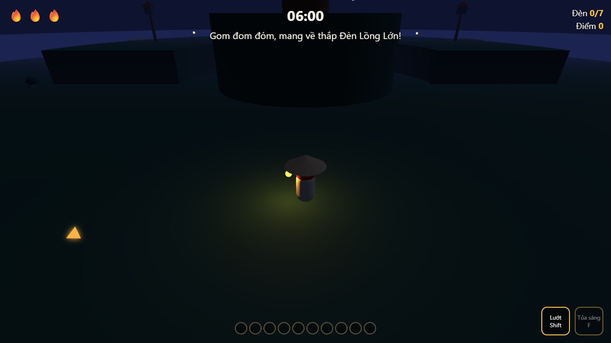

# Đảo Đèn Lồng — v1.0.0

> **Video demo (4:57):** [docs/demo/demo.mp4](docs/demo/demo.mp4) (cũng đính kèm ở [Release v1.0.0](../../releases/tag/v1.0.0)) · **Release:** [v1.0.0](../../releases/tag/v1.0.0) · Bằng chứng: [docs/proof/](docs/proof/README.md) · Retro: [docs/notes/retro.md](docs/notes/retro.md)

Game 3D góc nhìn thứ ba. Người chơi là **Mây**, người giữ đèn nhỏ tuổi đội nón lá treo đèn lồng. Mây đi qua **3 Đêm**: Đảo Bến, Đảo Cau (hai đảo nối bằng cầu tre), Đảo Chuông (ba tầng, có gió mạnh). Mỗi đêm Mây gom đom đóm, thắp và châm dầu cho các Đèn Lồng Lớn, né **Bóng Mực** (chúng hút dầu đèn) và **Gió Lạc** (chúng cướp đom đóm). Mục tiêu là giữ đảo sáng tới bình minh.



## Yêu cầu hệ thống
- **Node.js ≥ 20** (đã thử với Node 24). macOS, Linux hoặc Windows.
- Trình duyệt có WebGL2: Chrome, Edge, Firefox hoặc Safari. Lệnh bench cần **Chrome hoặc Chromium**.
- Đo trên laptop Intel i7-9750H + Intel UHD 630: bench khoảng 105–112 FPS trung bình với 200 Bóng Mực.

## Cài đặt và chạy (2 lệnh)
```bash
npm ci
npm start          # build + mở http://localhost:5173 (bảng xếp hạng lưu ở ~/.dao-den-long/leaderboard.json)
```
Không muốn cài gì: tải `dao-den-long-v1.0.0-web.zip` từ [Release](../../releases/tag/v1.0.0), giải nén, rồi chạy `node scripts/serve.mjs`.

## Điều khiển (đổi được trong Cài đặt)
| Phím mặc định | Hành động |
|---|---|
| `W` `A` `S` `D` | Đi (theo hướng camera) |
| `Space` | Nhảy |
| `Shift` | Lướt (14 m/s trong 0.2 s, hồi chiêu 1.5 s) |
| `E` | Tương tác: nạp đom đóm để thắp đèn, thắp lại, hoặc châm dầu |
| `F` / chuột trái | Tỏa sáng: tốn 3 đom đóm, choáng và đẩy lùi Bóng Mực trong 5 m |
| Chuột (bấm vào màn hình để khóa) / `←` `→` | Xoay camera |
| `Esc` / `P` | Tạm dừng: Tiếp tục / Chơi lại Đêm / Cài đặt / Về menu |

**Cài đặt** (được lưu): âm lượng, độ nhạy chuột, **đổi phím** cho mọi hành động (báo khi trùng phím, có nút "Khôi phục mặc định"), **bảng màu dễ phân biệt**, **giảm chuyển động** (tắt rung camera và chớp màn hình), **chữ lớn ×1.25**. Có phụ đề cho các sự kiện: Bóng Mực xuất hiện (kèm mũi tên chỉ hướng ở mép màn hình), gió sắp thổi, 10 giây cuối, đèn sắp cạn dầu.

## Luật chơi
- 3 **Ngọn Lửa**, hồi đầy ở đầu mỗi đêm. Bị Bóng Mực chạm thì mất 1 và rơi một nửa số đom đóm đang mang. Rơi khỏi đảo thì mất 1 và mất hết đom đóm.
- Đèn cần 10 đom đóm để thắp lần đầu, và 5 để thắp lại. Đèn sáng hao **1 dầu/giây**. Châm dầu bằng `E` (mỗi đom đóm +10 dầu). Dầu dưới 30 thì đèn mất vùng an toàn 6 m, và Bóng Mực sẽ tới hút dầu (5/giây).
- **Thắng khi tới bình minh** (4:00 / 4:30 / 5:00) còn ít nhất **3/5, 4/6, 5/7** đèn sáng. Thua thì được chơi lại đêm đó.
- Sức chứa đom đóm bằng 10 + 2 × số lần thắp thành công trong đêm, tối đa 20. **Bùa Gió** (lá bùa đỏ): chạy nhanh và lướt không cần hồi chiêu trong 10 s.

## Cách tính điểm
| Sự kiện | Điểm |
|---|---|
| Mỗi đom đóm nạp vào đèn (thắp, thắp lại, châm dầu) | +5 |
| Thắp lần đầu / thắp lại | +100 / +40 |
| Bóng Mực trúng Tỏa Sáng | +5 (+15 nếu nó đang hút dầu) |
| Bình minh (khi thắng): mỗi đèn đang sáng | +50 + số dầu còn lại (làm tròn xuống) |
| Bình minh (khi thắng): mỗi Ngọn Lửa còn lại | +50 |

Menu chính có **Chọn đêm (1/2/3)** để luyện tập hoặc demo một đêm bất kỳ. Khi demo có thể thêm `?lit=K` vào URL để thắp sẵn K đèn; điểm của lượt có `?lit` **không** được lưu vào bảng xếp hạng.

Tổng điểm là tổng điểm các Đêm đã thắng. Sau màn Bình Minh, hoặc khi thua, bạn có thể nhập tên để lưu vào **Bảng xếp hạng** top 10 (mở từ menu chính).

## Test, headless, bench, soak
```bash
npm test                                                     # 52 test (luật v1.0 -> v1.3, chạy qua CLI headless)
node src/headless/cli.js --seed 1 --night 2 --ticks 3600 --out out.jsonl [--scenario s.json] [--inputs i.json] [--snapshot-every 10]
npm run build && node scripts/bench.mjs --seed 42 --duration 30 --out bench.json   # cửa sổ Chrome 1280x720, vsync tắt
node --expose-gc scripts/soak.mjs --seed 7 --nights 10 --out soak.json            # 10 đêm trong 1 tiến trình
node scripts/serve.mjs --export-leaderboard out.json         # xuất bảng xếp hạng {"entries": [...]}
node scripts/ui-smoke.mjs                                    # smoke test UI (đổi phím, cài đặt, bảng xếp hạng) qua Chrome
```
- **Test Contract v1.3**: [game.contract.json](game.contract.json) (`build_cmd`, `run_cmd`, `headless_cmd`, `bench_cmd`, `soak_cmd`, `tuning`).
- **Bench**: game là bản web, nên bench mở một cửa sổ ứng dụng Chrome 1280×720 với `--disable-gpu-vsync --disable-frame-rate-limit` (tức vsync **tắt**). Cảnh bench chuẩn: 200 Bóng Mực, 100 đom đóm, L1–L3 sáng. Camera bay vòng bán kính 30 m, cao 15 m, 15 s một vòng. `peak_mem_mb` là tổng RSS (working set) của mọi tiến trình thuộc phiên Chrome đó. Có thể chỉ định trình duyệt bằng `--chrome <path>` hoặc biến `CHROME_PATH`. Chạy trên CI không có màn hình thì thêm `--headless`.
- **Soak**: `mem_end_mb` được đo sau khi reset đêm cuối và chờ GC ổn định 1 s. Báo cáo kèm `heap_*_mb` để thấy heap JS không tăng.
- Kết quả tự đo: [bench.json](bench.json), [soak.json](soak.json).

## Cấu trúc
- `src/core/`: logic thuần, tất định (`sim.js`, `maps.js` 3 bản đồ chuẩn, `tuning.js` số chuẩn, `leaderboard.js`)
- `src/render/`: Three.js (`world.js`), UI (`main.js`), âm thanh WebAudio (`audio.js`)
- `src/headless/cli.js`: entry point cho Test Contract. `scripts/`: launcher, bench, soak, fps, smoke test UI, bot, script bằng chứng
- Thiết kế: [ADR 0001](docs/adr/0001-lantern-fuel-and-dawn-win.md) · [CHANGELOG](CHANGELOG.md) · Tài liệu lab: [docs/lab/](docs/lab/LAB-README.md)
- Ghi chép: [spec Phase 2](docs/notes/spec-phase2.md), [giả định](docs/notes/assumptions.md), [nhật ký AI](docs/notes/ai-log.md), [retro](docs/notes/retro.md)
- Harness AI: [AGENTS.md](AGENTS.md) (+ [CLAUDE.md](CLAUDE.md)), hook Stop chặn agent kết thúc khi test đỏ ([.claude/settings.json](.claude/settings.json)), skill [verify-phase](.claude/skills/verify-phase/SKILL.md), [CI](.github/workflows/ci.yml) (Ubuntu và macOS)

## Sáng tạo của tôi
- Toàn bộ âm thanh tổng hợp bằng WebAudio (nhạc ngũ cung và hiệu ứng), không dùng file asset nào.
- Lời dẫn của Ông Đăng cho từng đảo, mắt tím của Bóng Mực, dải lụa uốn lượn của Gió Lạc, lá bay báo gió, Bóng Mực trồi lên từ sương khi xuất hiện.
- Tất cả chỉ nằm ở phần hiển thị (`src/render/`), không đổi đầu ra headless: 52 test qua CLI vẫn đạt. Cảnh bench chỉ dùng thực thể chuẩn.

## Giấy phép
Mã nguồn: [MIT](LICENSE). Nguồn và công cụ: [CREDITS.md](CREDITS.md).
